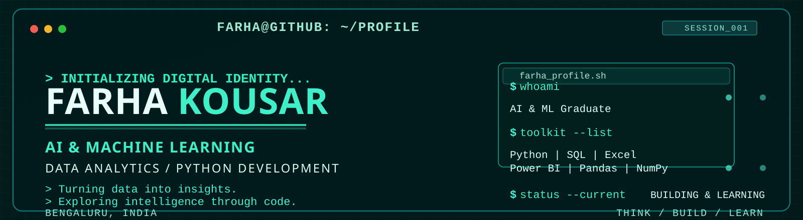

# Hi, I'm Farha Kousar 👋

B.E. graduate in Artificial Intelligence & Machine Learning with a strong focus on data-driven problem solving, analytics, and AI-powered solutions.

## About Me

- 🎓 B.E. in Artificial Intelligence & Machine Learning
- 📊 Interested in Data Analytics, AI/ML, Business Intelligence, and Predictive Modeling
- 💻 Skilled in Python, SQL, Power BI, Tableau, Excel, and Looker Studio
- 🧠 Exploring Deep Learning, LLMs, Generative AI, and practical AI workflows
- 🤝 Open to opportunities in Data Analytics, AI/ML, and related roles

## Core Skills

## Current Focus

- AI/ML experimentation and model building
- Business intelligence and dashboard development
- Data storytelling and actionable insights
- Generative AI and LLM-based workflows
- Learning by building practical, real-world projects

## Experience

- Wadhwani Foundation — Data Analytics Intern
  - Managed data workflows, reporting processes, and dashboards.
  - Built institutional onboarding and operational reporting support.

- Rooman Technologies — AI/ML Intern
  - Worked on practical AI/ML tasks including classification and data-driven problem solving.

- Infosys Springboard — Python Developer Intern
  - Built Python-based solutions and improved implementation workflows.

## Featured Projects

- EcoAI — Waste Classification
  - Teachable Machine + Image Classification + AI/ML

- Smart Discount Analyzer
  - Python + Data Analytics + Looker Studio

- Walmart Sales Dashboard
  - Power BI + Data Visualization

- KickStartX — NextStep After 12th
  - AI Chatbot + Workflow Automation

## Connect

- 📍 Bengaluru, Karnataka, India
- ✉️ [farhakousar576@gmail.com](mailto:farhakousar576@gmail.com)
- 💼 [LinkedIn](https://www.linkedin.com/in/farha-kousar)
- 🧠 [GitHub](https://github.com/FarhaKousar1601)
- 📊 [Kaggle](https://www.kaggle.com/farhakouser)
- 📝 [Dev.to](https://www.dev.to/FarhaKousar16)

## GitHub Stats

  

  

_Actively looking for opportunities in AI, data, and analytics._

---

  

